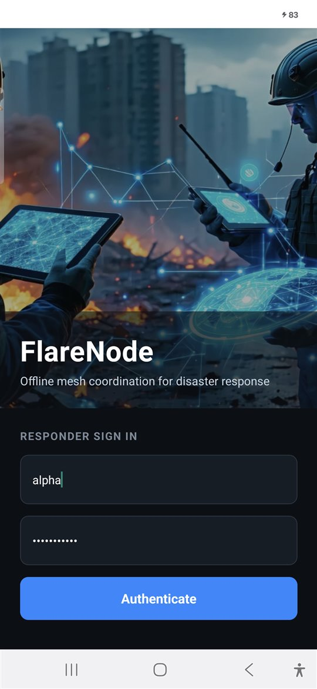
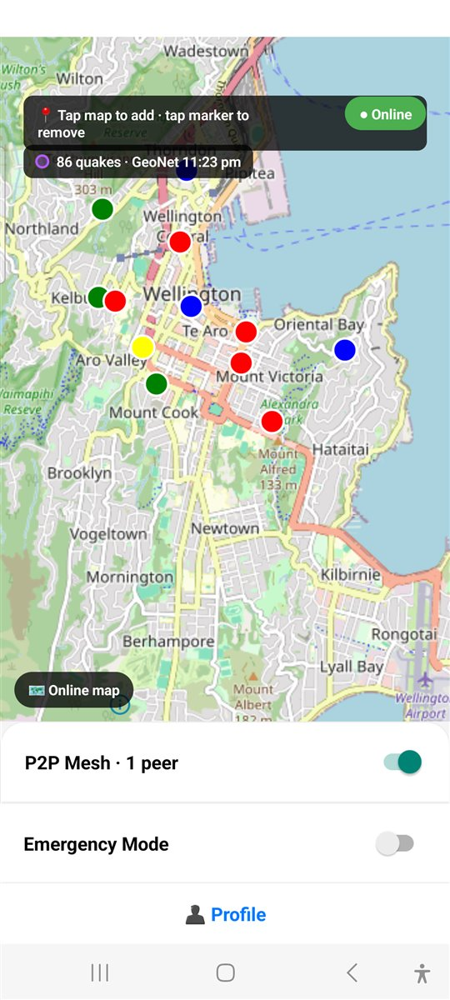
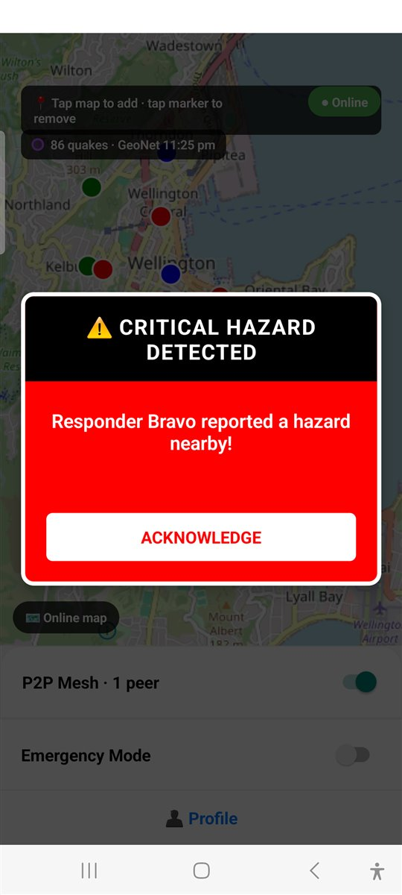
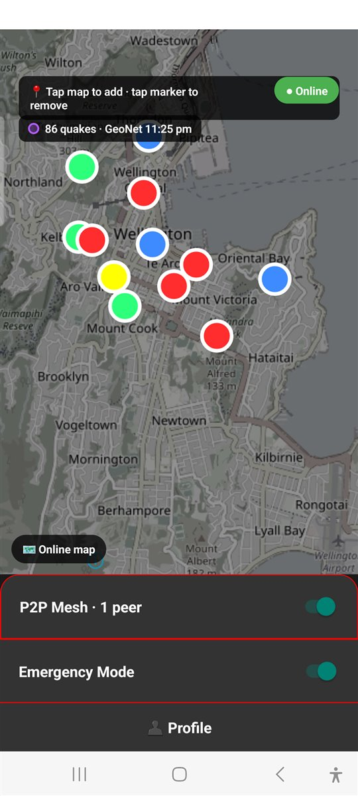

# FlareNode - Decentralized Disaster Response

> **Local-first coordination platform for zero-connectivity disaster response**

FlareNode lets responders share what they see on a map (hazards, resources, dead zones) directly from phone to phone, with no internet, mobile coverage or server needed in the field. It is open source under the [Apache License 2.0](./LICENSE).

> **Experimental software.** FlareNode is a working prototype tried on two phones. Its security design has not been independently reviewed. Do not rely on it where lives depend on it.

FlareNode was submitted to the IEEE Impact Challenge 2026; the result was not known at the time of writing. The version demonstrated there was 2.0.0-beta.1, which used the proprietary Ditto SDK for phone-to-phone sync; everything since has replaced that with FlareNode's own open mesh.

## 📸 Screenshots

<table>
  <tr>
    <td align="center"><br>Sign in</td>
    <td align="center"><br>Shared map, one peer connected</td>
    <td align="center"><br>Hazard reported by another responder</td>
    <td align="center"><br>Emergency Mode</td>
  </tr>
</table>

Taken on a Galaxy S20 FE in central Wellington with the demo accounts. Markers are red for hazards, blue for infrastructure, green for responders.

## 🚦 Current Status

**Last Updated:** October 11, 2026

**Version:** 3.0.0-rc.2, a release candidate. Phone-to-phone sync runs on FlareNode's own mesh. The Ditto SDK that earlier versions used is gone, along with the Ditto account, token and licence terms it needed. The radio layer of the normal app is Google Nearby Connections.

**In progress:** FlareNode's own open-source radios, to replace Google Nearby Connections. Bluetooth, Wi-Fi Aware and the local network are written and have connected and carried markers on two phones. They are switched on only in the separate Mesh Lab build until proven. See [Phone-to-Phone Mesh](#-phone-to-phone-mesh).

**Getting the app:** Android installers for the normal app and for Mesh Lab are on the [Releases page](../../releases), with install notes, or build from source with the [Quick Start](#-quick-start-android-windows) below. The installers are signed with a debug key and have no server address built in: you run your own Mothership and enter its address on the login screen.

This repository starts from the Ditto-free code; earlier versions are not part of its history.

| Platform | State |
|---|---|
| Android | Runs on two test phones (Galaxy S20 FE on Android 13, Galaxy S24+ on Android 16) from a standalone release build |
| iOS | Compiles on EAS Build as a simulator build, last on October 8 after Ditto was removed. Never run on a device or simulator. **No phone-to-phone sync:** the radio layer is written for Android only and has not been written for iPhone, so on iOS markers would travel only through the Mothership. |
| Mothership | Runs locally on Windows with SQLite; dashboard in the browser |

### ✅ Working
- Map on MapLibre with OpenStreetMap tiles (no Google Maps key)
- Phone-to-phone marker sync over FlareNode's own mesh (`src/mesh`), with no internet or router needed, and a live peer count and joined/left notices by responder name. The normal app uses Google Nearby Connections as its radio layer (Bluetooth and Wi-Fi)
- Mesh messages are sealed with a key made from the operational token, and every record is signed by the responder who wrote it. The app ships with a demo token (`OP-2026-S1`) that is public knowledge; set your own on every phone before real use
- The Mothership relays markers between phones that never meet
- Drop and remove markers; removals reach every responder
- Removal rules: a marker can be removed by whoever added it or by an admin; only admins can clear dead zones. Every phone checks these itself, so a modified app cannot get around them
- Hazard alerts with vibration
- Emergency Mode: darkened high-contrast map and larger markers
- Dead zones logged at the phone's GPS position, drawn on the map and exported
- Earthquake feed from GeoNet, shared across the mesh
- App lock (fingerprint, face or device PIN), saved login, offline entry after first sign-in
- Mothership address can be changed on the login screen without a rebuild
- Mothership backend with JWT auth, marker and dead-zone sync, live dashboard, ODK/GeoJSON export
- Responder accounts with roles (admin, responder), managed from the dashboard
- Offline map packs: a Wellington city pack ships in the app, and other regions can be downloaded from the Mothership (confirmed by the project owner on a Galaxy S20 FE)

### 🧪 What has and has not been checked on phones

All checks were on the two test phones.

**The normal app (Google Nearby as the radio layer)**
- Installed on both phones on October 7 and checked by the project owner with two responders. The Galaxy S20 FE log shows the phones connecting and records crossing in both directions with nothing refused and no save or send errors
- Before that, the same mesh was checked in the Mesh Lab build: two signed-in responders, markers in both directions, removal, and sync over Bluetooth with Wi-Fi off

**FlareNode's own radios (Mesh Lab build, October 8)**
- All three connected between the two phones at the first attempt: Bluetooth in 0.5 s, the local network in 1.0 s, Wi-Fi Aware in 2.3 s. Google Nearby took 7.0 s
- A marker crossed over the local network
- With Wi-Fi off, markers crossed over Bluetooth in both directions. One direction is confirmed from the receiving phone's log; the other from the sending phone's log and the project owner seeing the markers arrive
- When Wi-Fi was switched off, the mesh moved from the Wi-Fi link to the Bluetooth one without the other phone leaving the peer list

**Not tried or not settled**
- Wi-Fi Aware carrying markers by itself: reported working by the project owner. Not confirmed from a phone log; the one log read afterwards (Galaxy S20 FE) showed that phone's Wi-Fi off and no Wi-Fi Aware activity in the time it covered
- Bluetooth with Google Nearby switched off altogether. Nearby was connected in the background as the fallback during these tests
- A 15-minute stretch in which the Bluetooth link was down and did not come back by itself (Nearby held the connection, so nothing was lost). The phones may simply have been idle; not yet explained
- Three or more phones, a phone relaying between two that are out of each other's range, range, long sessions, battery use, and the app in the background

### 🔧 Not done yet
- The first sign-in needs the Mothership, to get the responder's mesh certificate. After that the phone works offline until the certificate runs out (90 days)
- No way to cancel a responder's certificate early
- The mesh stops when the app is in the background
- Phone-to-phone sync on iOS. Every radio layer so far is Android only
- Proving FlareNode's own radios and removing Google Nearby Connections. They work on two phones, but run only in the Mesh Lab build
- Reaching responders who are kilometres apart. A long-range LoRa broadcast is on the roadmap as a possible integration; nothing is built and there is no hardware to test with
- HTTPS for the Mothership
- An iOS build that installs on an iPhone, and any testing on iOS
- Release signing (builds are signed with the debug key)
- A verified build from a fresh clone
- Automated tests for the screens (the mesh core and the Mothership API are tested; see Tests below)

See `ROADMAP.md`, `DITTO_REPLACEMENT.md` and `src/mesh/README.md` for the longer-term items and the mesh's known limits.

### 🔄 What changed since 2.0.0-beta.1

| Area | 2.0.0-beta.1 | Now |
|---|---|---|
| Phone-to-phone sync | Ditto SDK (closed source) | FlareNode's own mesh in `src/mesh`: store, sync, sealing and signing, with 90 automated tests |
| Radio layer | Inside Ditto | Google Nearby Connections in the normal app; FlareNode's own Bluetooth, Wi-Fi Aware and local network radios in the Mesh Lab build |
| Accounts and keys needed | A Ditto account, database ID and token in `.env` | None for sync. `.env` holds only the Mothership address |
| Who may change what | Checked by the app and the Mothership | Checked by every phone: each record is signed by the responder who wrote it, against a certificate from the Mothership |
| Privacy on the air | Ditto's | Messages sealed with a key made from the operational token |
| Relay between phones that never meet | Ditto's cloud | The Mothership, which passes on signed records it cannot alter unnoticed |
| Storage on the phone | Ditto's store | SQLite |
| First sign-in | Needs internet for Ditto and the Mothership | Needs the Mothership only |
| APK size | About 120 MB | 44 MB |
| Licence terms on a build | Ditto Binary License applied | None from Ditto. See [Third-Party Software](#%EF%B8%8F-third-party-software) |
| iOS | Compiled with Ditto | Compiles without it; no radio layer for iPhone yet |
| Existing markers | | Not carried over; the map starts empty |

**Coming from 2.0.0-beta.1:** markers made with the Ditto version are not carried over, so the map starts empty. The Ditto values in an existing `.env` are no longer read and can be deleted.

## 📋 Quick Start (Android, Windows)

**You need:** Node.js 18 or newer, a JDK 17 or 21, the Android SDK with `adb`, and a phone with USB debugging enabled. The project uses Expo SDK 51. Phones need Google Play services, which provides the Nearby Connections radio layer the normal app uses.

1. **Install dependencies**
   ```
   npm install
   ```

2. **Add your settings**
   Copy `.env.example` to `.env` and fill in the Mothership address (the LAN
   address of the machine that will run it). Copy `mothership-server/.env.example` to
   `mothership-server/.env` and set its secrets. Both `.env` files are
   git-ignored. The app values are baked in at build time, so rebuild after
   changing them.

   `app.json` names the original Expo account (`owner`) and project (`extra.eas.projectId`). They only matter for EAS Build; to use EAS yourself, remove both and run `npx eas-cli init`.

3. **Generate the Android project** (only if there is no `android/` folder)
   ```
   npx expo prebuild -p android
   ```
   The `android/` folder is git-ignored. Generating it from a fresh clone has
   not been verified end to end.

4. **Start the Mothership and create the demo accounts**
   ```
   scripts\seed-mothership.bat
   scripts\start-mothership.bat
   ```
   The dashboard is at http://localhost:3000/. Sign in as `admin` with the
   password you set as `SEED_PASSWORD`.

5. **Build the app and install it on the connected phones**
   ```
   scripts\build-and-install.bat
   ```

6. **On each phone:** unlock the app, sign in as `alpha` or `bravo` while on the
   same network as the Mothership, and allow the Bluetooth, nearby-devices and
   location prompts. Keep Bluetooth on for the mesh.

### Accounts and roles

| Account | Role | Can do |
|---|---|---|
| `admin` | admin | Everything a responder can, plus remove any marker, clear dead zones, and manage responders on the dashboard |
| `alpha`, `bravo` | responder | Drop markers, remove their own markers, sync, download map packs |

Admins add responders, reset passwords and remove accounts in the dashboard's
**Responders** section. Roles are issued at sign-in, so log out and back in after
a role changes.

## 🛠️ Build & Run Scripts (Windows)

Run these from the project root:

| Script | What it does |
|---|---|
| `scripts\build-app.bat` | Builds the standalone Android release APK (arm64, JS bundled in) |
| `scripts\install-app.bat` | Installs the last built APK on every phone connected over USB and opens the app |
| `scripts\build-and-install.bat` | Both of the above |
| `scripts\build-mesh-lab.bat` | Builds the Mesh Lab variant (see [Phone-to-Phone Mesh](#-phone-to-phone-mesh)), installs it next to the normal app on every connected phone and opens it |
| `scripts\start-mothership.bat` | Starts or restarts the Mothership API and dashboard on port 3000 |
| `scripts\seed-mothership.bat` | Creates or resets the demo responders (`admin`, `alpha`, `bravo`) |
| `scripts\build-map-pack.bat` | Builds an offline map pack for a region, for the Mothership to serve or to bundle in the app |

They need `.env` and `mothership-server\.env` (see the `.env.example` files), a
JDK 17 or 21, and the generated `android\` folder.

These scripts are for Android. For iOS see [iOS (EAS Build)](#-ios-eas-build).

## ✅ Tests

| Command | Where | What it covers |
|---|---|---|
| `npm run test:mesh` | project root | The mesh in `src/mesh`: sync between phones, relaying, conflicts, removals, sealing, signing and the rules, storage, lost messages, several radios at once, the app-facing service |
| `npm test` | `mothership-server` | The Mothership API end to end, against a throwaway database: sign-in and roles, responder management, marker and dead-zone sync, removal rules, exports, map packs |

Both run on every push through GitHub Actions (`.github/workflows/tests.yml`). Neither needs a phone or any secret. There are no automated tests for the app's screens.

## 📡 Phone-to-Phone Mesh

FlareNode's sync is its own code. It replaced the Ditto SDK in 3.0.0-rc.1.

### How it is put together

```
   the app (map, markers, dead zones, quake feed)
        |
   mesh service      saveMarker, subscribeToMarkers, observePeers, ...
        |
   store + sync      who has what, newest wins, removals remembered
        |
   sealing + signing a shared key from the operational token; every record
        |            signed by the responder who wrote it
   transport         "find phones, tell me when one connects, move messages"
        |
   radios            Google Nearby | Bluetooth | Wi-Fi Aware | local network
```

Everything above the transport line is plain JavaScript in `src/mesh` and is tested without a phone. A radio only has to do the three things on the transport line, which is what lets one be swapped for another.

- **Every phone holds everything** and passes on what it receives, so a marker reaches phones that are out of range of its author through the phones in between.
- **Phones that were apart catch up** when they meet, in both directions, including removals.
- **Rules are enforced by every phone.** A responder adds markers as themselves and removes their own; an admin may remove any; only an admin clears a dead zone. A record that breaks the rules is not stored and not passed on, whatever app sent it.
- **The Mothership is a carrier.** It issues each responder's certificate at sign-in and relays signed records between phones that never meet. It cannot add, change or remove a record unnoticed.

How it works in detail, what it protects against and what it does not: [src/mesh/README.md](./src/mesh/README.md).

### The radios

| Radio | Shows in the log as | Works when | Open source | Where it runs |
|---|---|---|---|---|
| Google Nearby Connections | `nearby` | Bluetooth or Wi-Fi on; needs Google Play services | No | The normal app, and Mesh Lab as the fallback |
| Local network | `wifi` | Both phones on the same Wi-Fi network, or one on the other's hotspot | Yes | Mesh Lab |
| Wi-Fi Aware | `wifi-aware` | Wi-Fi switched on, no network needed; only on phones that have Wi-Fi Aware | Yes | Mesh Lab |
| Bluetooth Low Energy | `bluetooth` | Bluetooth on; no network of any kind. Android 10 or later | Yes | Mesh Lab |

The three open-source radios are FlareNode's own, written on what Android itself provides, with nothing from Google Play services. They are in one native module, `modules/flarenode-radio`. When several radios reach the same phone, the mesh shows it as one peer, uses the fastest and falls back to the others if that one drops.

**Range** is what phone radios give: typically 30-50 m for Bluetooth and up to about 100 m for direct Wi-Fi in the open, less indoors or through people. These are general figures, not measurements on the test phones. Phones in between extend it by passing records on. Ditto had the same limits, since it used the same radios.

### Mesh Lab

Mesh Lab is a second build of the same app that installs next to FlareNode under its own app id and keeps its own data. It is where a radio is tried before the normal app relies on it: today it runs the three open-source radios ahead of Google Nearby.

```
scripts\build-mesh-lab.bat
```

- Only one of the two apps can be open on a phone at a time; they cannot share the mesh radio. Swipe the other away first.
- Both builds are on the same mesh, so a phone on Mesh Lab and a phone on the normal app do sync with each other (over Nearby).
- The login screen of Mesh Lab links to a bare test bench for looking at a radio by itself.

### Where the replacement stands

| Stage | State |
|---|---|
| Sync core, tested in memory | Done |
| Google Nearby Connections as the first radio | Done |
| Storage, sealing, per-responder signing, Mothership relay | Done |
| Ditto removed from the app | Done, in 3.0.0-rc.1 |
| Several radios at once | Done |
| Own radios: local network, Bluetooth, Wi-Fi Aware | Written and connecting on two phones; being proven in Mesh Lab |
| Google Nearby removed | Not started; after the above are proven |
| Long-range LoRa broadcast | Possible integration; see `ROADMAP.md` |

The full plan, test records and reasoning are in [DITTO_REPLACEMENT.md](./DITTO_REPLACEMENT.md).

## 🍎 iOS (EAS Build)

iOS is built in the cloud with [EAS Build](https://docs.expo.dev/build/introduction/), so no Mac is needed to build.

**Where it stands:** the app compiles and links for iOS. A simulator build finished successfully on October 8, 2026, after Ditto was removed (two earlier ones, with Ditto, on October 5). The app has never been opened on iOS, so nothing about how it behaves there is known.

**No phone-to-phone sync on iOS yet.** Every radio layer so far is Android only. On iOS the mesh switch would stay off and markers would travel only through the Mothership. The local network, Bluetooth data channels and, from iOS 26, Wi-Fi Aware exist on iPhone, so FlareNode's own radios are the route there; the iPhone side is not written.

**Build to check that iOS still compiles** (no Apple Developer account needed):

```
npx.cmd eas-cli login
npx.cmd eas-cli build -p ios --profile ios-simulator
```

This produces a simulator build, which cannot be installed on an iPhone. EAS prints "Open this link on your iOS devices to install the app" for every internal build; ignore it for this profile.

**Build that installs on an iPhone** needs an Apple Developer Program membership (about US$99 a year) and the iPhone registered with EAS:

```
npx.cmd eas-cli device:create
npx.cmd eas-cli env:push --environment preview --path .env
npx.cmd eas-cli build -p ios --profile preview
```

The build page then shows an Install button and QR code for registered devices.

**Notes**

- In PowerShell use `npx.cmd`, not `npx`; the default execution policy blocks the script wrapper.
- `.easignore` keeps `mothership-server/`, `tools/` and other things the app build does not need out of the upload, which is otherwise far larger.
- The `ios/` folder is git-ignored; EAS generates the native project from `app.json`.

The full steps are in [IOS_BUILD.md](./IOS_BUILD.md).

## 🗺️ Offline Map Packs

The app can draw its map with no network at all. It does this from a **map pack**: a single file of map data for one area, stored on the phone.

- One pack, **Wellington city**, ships inside the app.
- More packs can be built for **any area in the world** and downloaded to phones from the Mothership.

> Confirmed by the project owner on a Galaxy S20 FE on October 5, 2026. Not yet checked on the Galaxy S24+ or with all networks switched off.

### How the app uses a pack

- With internet, the map shows live OpenStreetMap tiles as before.
- With no internet, the map switches to the active pack automatically, in a light style or a dark one when Emergency Mode is on.
- The chip at the bottom-left of the map shows which map is in use. Tap it to force the offline map on or off, for example to demo it without turning networks off.
- **Profile > Offline map** lists the packs on the phone and those the Mothership offers. From there you can download a pack, switch to it, or delete it. Switching moves the map to that region.

### Building a pack for a region

```
scripts\build-map-pack.bat <id> "<name>" "<west,south,east,north>" [--bundle]
```

| Argument | Meaning |
|---|---|
| `id` | Short name used for the file: lowercase letters, digits and dashes, for example `lower-hutt` |
| `name` | The name shown in the app, in quotes |
| box | The area to cover in street-level detail, as four numbers in quotes: west and east are longitudes, south and north are latitudes. The quotes are required. |
| `--bundle` | Optional. Makes this pack the one built into the app instead of putting it on the Mothership. |

Examples:

```
scripts\build-map-pack.bat lower-hutt "Lower Hutt" "174.85,-41.25,174.98,-41.17"
scripts\build-map-pack.bat london-central "Central London" "-0.20,51.47,-0.05,51.55"
```

To find the four numbers for a place, draw a rectangle on [bboxfinder.com](http://bboxfinder.com) and copy the box it shows. Longitudes west of Greenwich and latitudes south of the equator are negative.

The first run installs the tool's own dependencies (`tools\map-pack`). Each run downloads the map data it needs, so it needs internet.

### Getting a pack onto phones

**From the Mothership (no rebuild):**

1. Build the pack without `--bundle`. It is written to `mothership-server\maps\`.
2. Make sure the Mothership is running (`scripts\start-mothership.bat`). It picks up new packs without a restart.
3. On the phone, signed in and on the same network: **Profile > Offline map > Download**.

**Built into the app:**

1. Build the pack with `--bundle`. It replaces `assets\maps\default.mbtiles`.
2. Rebuild and install the app: `scripts\build-and-install.bat`.

### What a pack contains

| Area | Detail |
|---|---|
| Inside the box | Street level, up to zoom 15: roads, buildings, land use, water, place names |
| About 0.5° around the box | Suburb level, zoom 10-12 |
| About 2° to 8° around the box | Region and country level, zoom 5-9 |
| The whole world | Outline level, zoom 0-4 |

Zooming in outside the box shows a blank map when offline, because street-level data is only stored for the box.

### Size

Size grows with the area of the box and with how built-up it is.

| Pack | Box | Size |
|---|---|---|
| Wellington city (bundled) | about 17 km x 18 km | 20 MB |
| Lower Hutt | about 11 km x 9 km | 16 MB |

A box twice as wide and twice as tall is roughly four times the size. A whole large metropolitan area can reach several hundred MB; split it into several packs instead. The bundled pack adds its size to the APK.

### Limits

- **Latin-script labels only.** The bundled fonts cover Latin characters, including Maori macrons. A pack for a region that labels places in another script (Japanese, Arabic, Cyrillic and so on) draws correctly but without those labels. More font ranges can be added in `tools\map-pack\build-pack.js` (`FONT_RANGES`), then run the tool with `--assets`.
- **No icons.** Shops and landmarks appear as labels, not symbols.
- **Fixed at build time.** A pack is a snapshot of the map on the day it was built. Rebuild it to pick up map changes.
- **Only two packs have been built so far** (Wellington city and Lower Hutt). Other regions use the same code but have not been tried.

### Where the data comes from

Packs are extracted from [Protomaps](https://protomaps.com) daily builds, which are OpenStreetMap data published so that regions can be extracted for offline use. The OpenStreetMap tile servers themselves do not allow bulk download, which is why they are not used for this. The map shows the attribution "© OpenStreetMap contributors · Protomaps".

### Files

| Path | What it is |
|---|---|
| `assets\maps\default.mbtiles`, `default.json` | The pack built into the app, and its description |
| `assets\maps\style-light.json`, `style-dark.json` | How the offline map is drawn |
| `assets\maps\fonts\` | Label fonts |
| `mothership-server\maps\` | Packs the Mothership serves (git-ignored; rebuild with the script) |
| `tools\map-pack\build-pack.js` | The tool that builds packs |
| `src\services\OfflineMap.js`, `src\components\MapPacks.js` | The app side |

## 🏗️ Architecture

```
Mobile Client (React Native, Expo SDK 51)
├── FlareNode mesh (src/mesh): store, sync, sealing, per-responder signing
│   ├── Radio in the normal app: Google Nearby Connections (Bluetooth, Wi-Fi), Android only
│   └── Own radios, Mesh Lab build only (modules/flarenode-radio): local network,
│       Wi-Fi Aware, Bluetooth Low Energy; several can run at once
├── expo-sqlite (mesh records)
├── MapLibre
│   ├── Online: OpenStreetMap raster tiles
│   └── Offline: bundled or downloaded vector map packs (MBTiles)
├── expo-location (position for dead zones)
├── expo-local-authentication (app lock)
└── expo-secure-store (session and settings)

Mothership Backend (Node.js/Express)
├── JWT authentication, admin and responder roles
├── Issues each responder's mesh certificate; relays signed markers between phones
├── SQLite by default, PostgreSQL optional (newest-wins sync, removals remembered)
├── Live dashboard with responder management
├── Offline map pack downloads
├── ODK CSV and GeoJSON export
└── Kubernetes deployment files

Tooling
├── scripts/            Windows build, install and server scripts
├── modules/            Native Android modules: flarenode-nearby, flarenode-radio
├── tools/map-pack/     Offline map pack builder
└── EAS Build           iOS builds in the cloud
```

## ⚖️ Third-Party Software

FlareNode no longer contains or depends on the Ditto SDK. Nothing of Ditto's is downloaded, built in or needed to run it, and Ditto's licence terms do not apply to builds from 3.0.0-rc.1 on.

**Google Nearby Connections** is the radio layer of the normal app. FlareNode's sync code (`src/mesh`) is its own; [Nearby Connections](https://developers.google.com/nearby/connections/overview) sits underneath it and is part of Google Play services.

- **Free, no account or key:** there is nothing to sign up for and no usage charge.
- **Not open source:** it is a closed component that runs inside Google Play services, used under [Google's APIs Terms of Service](https://developers.google.com/terms). Phones without Google Play services cannot use it.
- **Nothing of Google's is in this repository.** The build downloads the `play-services-nearby` client library.
- **Being replaced** by FlareNode's own radios, which use only Android's Bluetooth and Wi-Fi interfaces. See [Phone-to-Phone Mesh](#-phone-to-phone-mesh).

**Cryptography** comes from the MIT-licensed [noble](https://paulmillr.com/noble/) libraries. **Maps** are drawn with MapLibre from OpenStreetMap data; its terms, and the bundled fonts', are in [NOTICE](./NOTICE).

This is a summary for convenience, not legal advice.

## 📄 Licence

FlareNode is licensed under the [Apache License 2.0](./LICENSE). Copyright 2026 FlareNode contributors.

You may use, change and redistribute it, including commercially, provided you keep the licence and notices. It comes with no warranty. Work by others that FlareNode bundles or depends on, including the OpenStreetMap map data, is listed with its terms in [NOTICE](./NOTICE).

Contributions are welcome and are accepted under the same licence.

## 📖 Documentation

- [ROADMAP.md](./ROADMAP.md) - Gap analysis against the original proposal, and what comes next (own radios, long-range LoRa, iPhone)
- [IOS_BUILD.md](./IOS_BUILD.md) - iOS build status and steps
- [src/mesh/README.md](./src/mesh/README.md) - How the mesh works, what it protects against, and its limits
- [DITTO_REPLACEMENT.md](./DITTO_REPLACEMENT.md) - How the Ditto SDK was replaced, the open-source radios, and the record of each phone test
- [DEPLOYMENT_GUIDE.md](./DEPLOYMENT_GUIDE.md) - Kubernetes deployment instructions (predates the current setup; not reviewed recently)

## 🚀 Next Steps

1. Use 3.0.0-rc.2 for a while, then publish 3.0.0
2. Finish proving FlareNode's own radios in Mesh Lab: Wi-Fi Aware by itself with logs from both phones, Bluetooth with Nearby switched off, reconnecting after a drop, and measured range
3. Test with three phones, including one relaying between two that cannot reach each other
4. Move the normal app onto its own radios and remove Google Nearby Connections
5. Keep the mesh running in the background
6. Add a way to cancel a responder's certificate
7. Verify a build from a fresh clone and sign releases properly
8. Rebuild for iOS and write the iPhone side of the radios
9. Consider the long-range LoRa broadcast (see `ROADMAP.md`)

## 📞 Questions and Problems

- Open an issue on this repository for questions, bugs and ideas.
- If you find a security problem, please say so in an issue without the details of how to exploit it, so it can be fixed before those are public.

Background reading: [Google Nearby Connections](https://developers.google.com/nearby/connections/overview), [Expo EAS Build](https://docs.expo.dev/build/introduction/).

---
**Note:** This is an Expo project with native dependencies (MapLibre, Google Nearby Connections, and FlareNode's own radio module). The generated `android/` and `ios/` folders are git-ignored.
